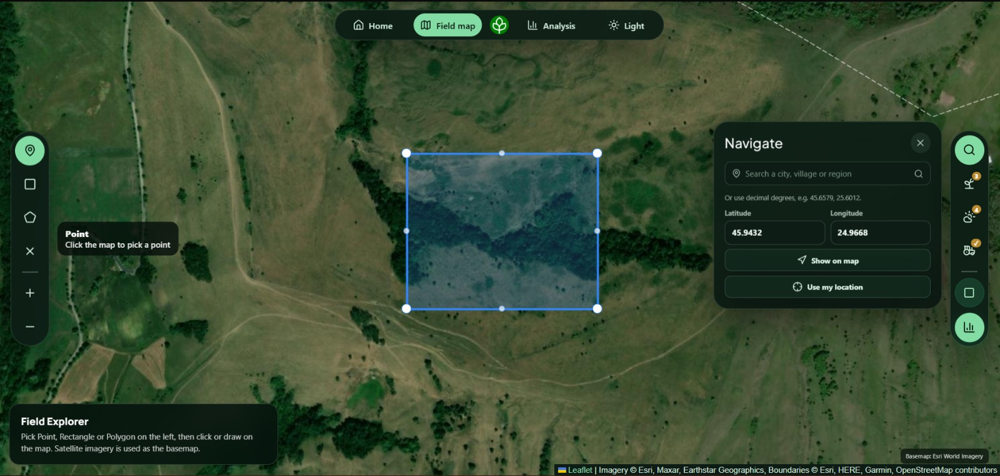
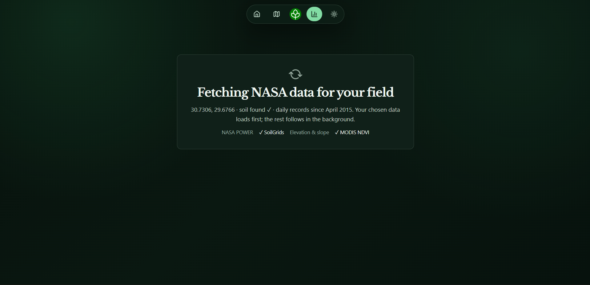
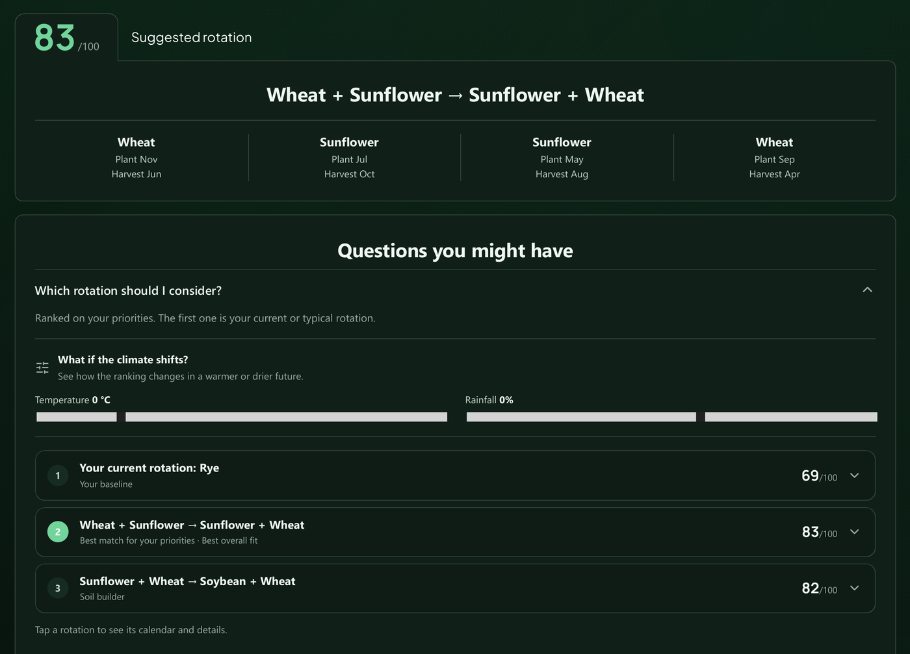
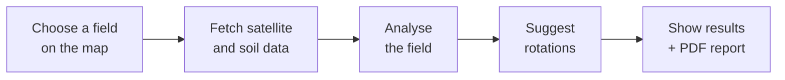
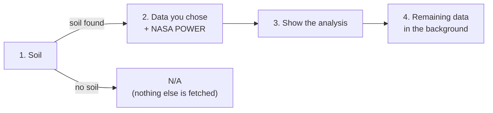
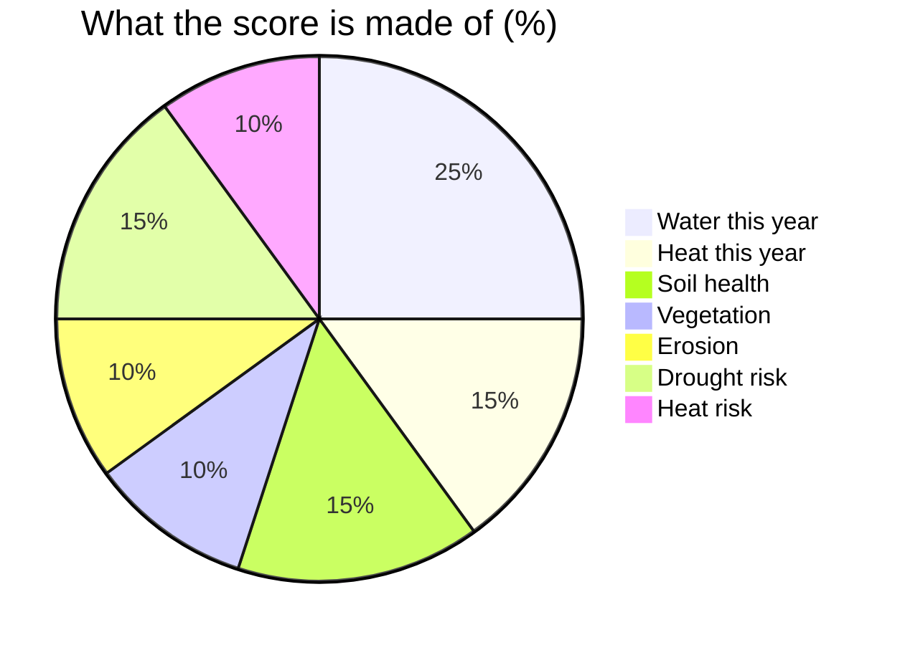
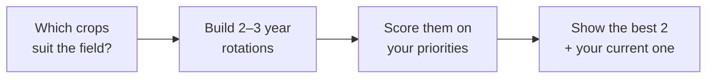

# AgroCycle

**Know which crop rotation will hold up on your field, from live NASA satellite data.**

[](https://react.dev)
[](https://www.typescriptlang.org)
[](https://vite.dev)
[](https://power.larc.nasa.gov)
[](#privacy)


Pick a point or draw a field anywhere on Earth. AgroCycle checks how the field is doing this year against earlier years and compares crop rotations, your current one included. Every suggestion says why it was picked, what backs it up, its risks and what is still unknown. The farmer makes the final call.

**Contents:** [Features](#features) · [Quick start](#quick-start) · [Configuration](#configuration) · [Screenshots](#screenshots) · [How it works](#how-it-works) · [Data sources](#data-sources) · [Scores](#scores) · [FAQ](#faq) · [Project structure](#project-structure) · [Limitations](#limitations) · [Credits](#credits)

---

## Features

| Feature | What you get |
|---|---|
| Any location | Click a point, draw a rectangle or polygon, search a place or type coordinates. |
| Live data | Up to 12 sources (NASA, Copernicus, USDA, USGS…). A missing value shows "—", never a guess. |
| Your choices | The data you care about, your priorities (water, soil health, heat, erosion, pests, income) and what you grow today. |
| Field resilience | A 0–100 score, a plain verdict and the parts behind it. |
| Last 12 months | Key values coloured green, yellow or red against what is normal for the field. |
| Was this year normal? | Rain, soil moisture, hot days and frost days next to earlier years. |
| Rotations | Your current rotation and the 2 best alternatives, each with a calendar, evidence, benefits, risks and unknowns. |
| Local crops | Rice in Japan, wheat and sunflower in Romania, millet in dry parts of India. |
| Climate test | How the ranking changes in a warmer or drier future, or under 2041–2050 climate models. |
| Not farmable | Oceans, lakes, ice and cities show **N/A**. |
| PDF report | Every value for the field in one download. |
| Comfort | Light and dark theme, works on mobile. |

---

## Quick start

Requires Node.js 20.19+ and npm.

```bash
npm install
npm run dev
```

Open http://localhost:5173, click **Explore your field**, pick a spot on the map and press the analysis button.

| Command | What it does |
|---|---|
| `npm run dev` | Development server with the API proxy |
| `npm run build` | Type-check and build to `dist/` |
| `npm run preview` | Serve the build locally (proxy included) |
| `npm run lint` | Lint with Oxlint |

---

## Configuration

Everything works without configuration. Two US datasets need a free key. Copy the example file, then restart `npm run dev`:

```bash
cp .env.example .env
```

| Variable | Enables | Free key |
|---|---|---|
| `NASS_API_KEY` | Recent county crop yields (USDA NASS) | https://quickstats.nass.usda.gov/api |
| `OPENET_API_KEY` | Actual field water use (OpenET) | https://etdata.org/api/ |

The keys are read by the dev server (`vite.config.ts`) and never reach the browser. Without them, these sources show "Not enabled".

---

## Screenshots

### Field map
Pick a point, a rectangle or a polygon on satellite imagery, or search for a place, type coordinates or use your location. The buttons on the right open the data layers, the priorities and "Your farm".



### Loading the data
Soil is checked first. The chosen layers then load and are ticked off as each one arrives.



### Example: a full analysis
A complete analysis page for an 18 ha field in central Romania (45.9430, 24.9629), saved from the browser as a PDF.

📄 **[Open the full page as a PDF](docs/example/agrocycle-analysis-example.pdf)**

GitHub cannot show a PDF inside a README, so the same page is shown below as images, split into five parts.

<details open>
<summary><b>1 · Field resilience and the last 12 months</b></summary>


</details>

<details>
<summary><b>2 · Suggested rotation and the rotation options</b></summary>


</details>

<details>
<summary><b>3 · Which crops suit this field and was this year normal?</b></summary>


</details>

<details>
<summary><b>4 · When is the field most vulnerable and what could the coming years look like?</b></summary>


</details>

<details>
<summary><b>5 · How reliable is this, glossary and data sources</b></summary>


</details>

---

## How it works



Everything runs in the browser, with no database and no account. The only server code is a small proxy in `vite.config.ts` that keeps the two API keys out of the browser.

### Loading order



- Soil comes first. On water, ice or a city there is nothing to farm, so nothing else is requested.
- Results are cached for 12 hours (climate projections for 30 days), so switching pages sends no new requests.
- When a source fails, the page says so and offers **Try again**.

---

## Data sources

| Data | Produced by | Fetched from | What it gives | Coverage |
|---|---|---|---|---|
| **NASA POWER** (daily) | NASA Langley Research Center, from NASA GMAO MERRA-2 / GEOS | [POWER Daily API](https://power.larc.nasa.gov/) | Temperature, rain, surface and root-zone soil moisture since April 2015 | Worldwide, ~50 km |
| **MODIS NDVI** (MOD13Q1 / MYD13Q1) | NASA, Terra and Aqua satellites | [ORNL DAAC MODIS Web Service](https://modis.ornl.gov/data/modis_webservice.html) | How green the vegetation is, vs earlier years | Worldwide, 250 m |
| **SoilGrids 2.0** | ISRIC – World Soil Information | [SoilGrids REST API](https://rest.isric.org/) | Texture, organic matter, pH, bulk density (0–30 cm); land/water check | Worldwide, 250 m |
| **Copernicus GLO-90 DEM** | ESA / Copernicus | [Open-Meteo Elevation API](https://open-meteo.com/en/docs/elevation-api) | Elevation and slope | Worldwide, 90 m |
| **ERA5-Land** | ECMWF, Copernicus Climate Change Service | [Open-Meteo Historical Weather API](https://open-meteo.com/en/docs/historical-weather-api) | Second opinion on soil moisture since 2018 | Worldwide, ~9 km |
| **CMIP6 HighResMIP** (EC-Earth3P-HR, MPI-ESM1-2-XR, MRI-AGCM3-2-S) | WCRP climate modelling centres | [Open-Meteo Climate API](https://open-meteo.com/en/docs/climate-api) | Temperature, rain and hot days in 2041–2050 vs 1995–2014 | Worldwide |
| **Sentinel-2 L2A** | ESA / Copernicus | [Copernicus Data Space STAC](https://stac.dataspace.copernicus.eu/) | Latest clear image (< 20% cloud) and a link to view it | Worldwide, 10 m |
| **SSURGO** (Web Soil Survey) | USDA Natural Resources Conservation Service | [Soil Data Access](https://sdmdataaccess.sc.egov.usda.gov/) | Drainage class, hydrologic group, water-holding capacity | US |
| **Groundwater levels** | U.S. Geological Survey | [USGS Water Data OGC API](https://api.waterdata.usgs.gov/) | Depth and trend at the nearest well | US |
| **Quick Stats** \* | USDA National Agricultural Statistics Service | [Quick Stats API](https://quickstats.nass.usda.gov/api) | Recent county crop yields | US |
| **OpenET** \* | OpenET (NASA, USGS, Desert Research Institute and partners) | [OpenET API](https://etdata.org/api/) | Actual field water use | Western US |
| **Place names** | OpenStreetMap contributors | [Nominatim](https://nominatim.org/) | Country, region and county | Worldwide |

\* Needs a free API key, see [Configuration](#configuration).

The reliability notes draw on NASA's SMAP mission documentation, for example where satellite soil moisture is less accurate (dense vegetation, frozen soil).

---

## Scores

### Field resilience (0–100)

The score reflects how well the field is coping this year, plus its long-term risk. Each part gets a mark from 0 to 100. Parts without data are skipped, so a service being down never lowers the score.



| Score | Verdict |
|---|---|
| 75 or more | In good shape |
| 55–74 | Some pressure, worth watching |
| below 55 | Under significant pressure |

### Rotations



| Step | How |
|---|---|
| Crop fit | Each of the 30 crops in the library is tested month by month against the field's temperature, water, frost, heat and soil. |
| Local crops | Crops grown in the area (101 countries, plus USDA county yields in the US) are preferred. |
| Score | 40% fit with the field and the local market, 60% your priorities. A selected priority counts double. |
| Strategies | Best overall, water-saving, soil builder, local market and, in hot places, heat-resilient. |

### Outlook

| What | How |
|---|---|
| Trends | Temperature, rain, hot days, frost days and soil moisture, with a likely range. With no clear trend it says so instead of extrapolating. |
| Odds | Share of the last 10 years with a dry season, a hot year or a late frost. |
| Climate models | CMIP6 mean for 2041–2050. |

---

## FAQ

**A source shows "Not enabled".**
It needs an API key, see [Configuration](#configuration).

**A source shows "Not used here".**
It covers only the US (SSURGO, USGS, NASS, OpenET).

**The page says N/A.**
No soil was found at that point (sea, lake, ice or a built-up area). Pick a spot on farmland.

**Vegetation greenness loads slowly.**
The ORNL DAAC MODIS service can take 30–60 seconds. The rest of the page is usable meanwhile.

**A source failed.**
Press **Try again**. Open-Meteo limits the number of requests per minute, so a retry a minute later usually works.

---

## Project structure

```text
src/
├── pages/        Home, Map, Analysis
├── components/   map, cards, rotation calendar, navigation
├── services/     fetching and caching the data
├── utils/        the analysis: field, crops, rotations, scores, PDF report
├── data/         crop library, local crops per country, NASA SMAP facts
└── types/        shared types
docs/             screenshots and the example analysis
vite.config.ts    proxy that keeps the API keys on the server
```

| File | Role |
|---|---|
| `src/utils/fieldAnalysis.ts` | Field analysis and resilience score |
| `src/utils/rotations.ts` | Rotation builder and strategies |
| `src/services/sourceStore.ts` | Data loading, status and caching |
| `src/utils/fieldReport.ts` | PDF report |

---

## Privacy

- No accounts, no database. The selected field stays in the browser tab and is cleared when it closes.
- Only the coordinates are sent to the data providers.
- API keys stay on the server.

---

## Limitations

- Satellite data is coarse (NASA POWER ~50 km, MODIS 250 m), so differences inside a field are averaged out.
- The daily record starts in 2015, so trends rest on about 10 years.
- Prices, pests, varieties and machinery are not modelled. Each rotation lists what it cannot see.
- The NASS/OpenET proxy runs only with `npm run dev` or `npm run preview`. A static host needs an equivalent serverless function.

---

## Credits

Data: NASA (POWER, MODIS, SMAP) · ESA / Copernicus (Sentinel-2, ERA5-Land, GLO-90 DEM) · ISRIC SoilGrids · USDA (NRCS, NASS) · USGS · OpenET · Open-Meteo · OpenStreetMap.

Built with React, TypeScript, Vite, Leaflet and Three.js.

## Team

Copiii Copaci IESC