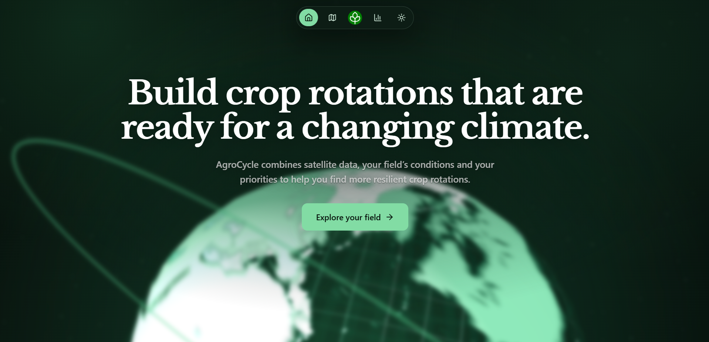
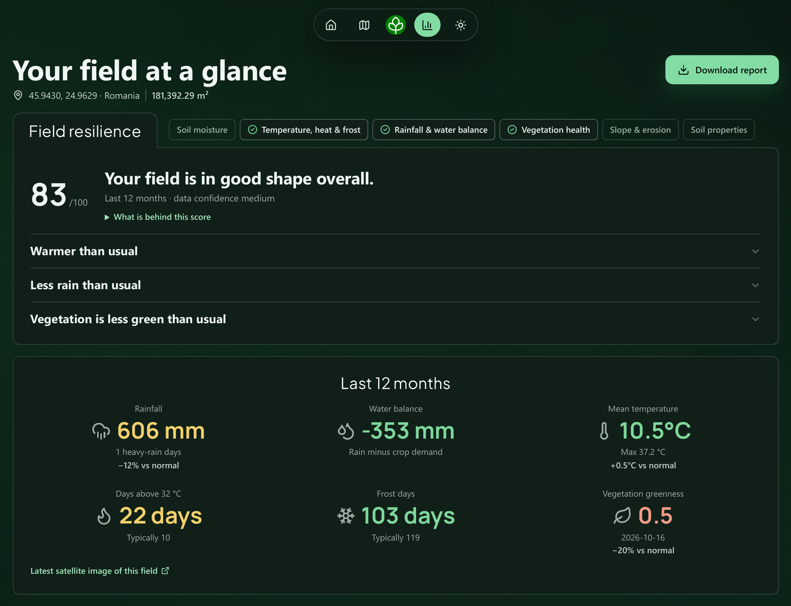
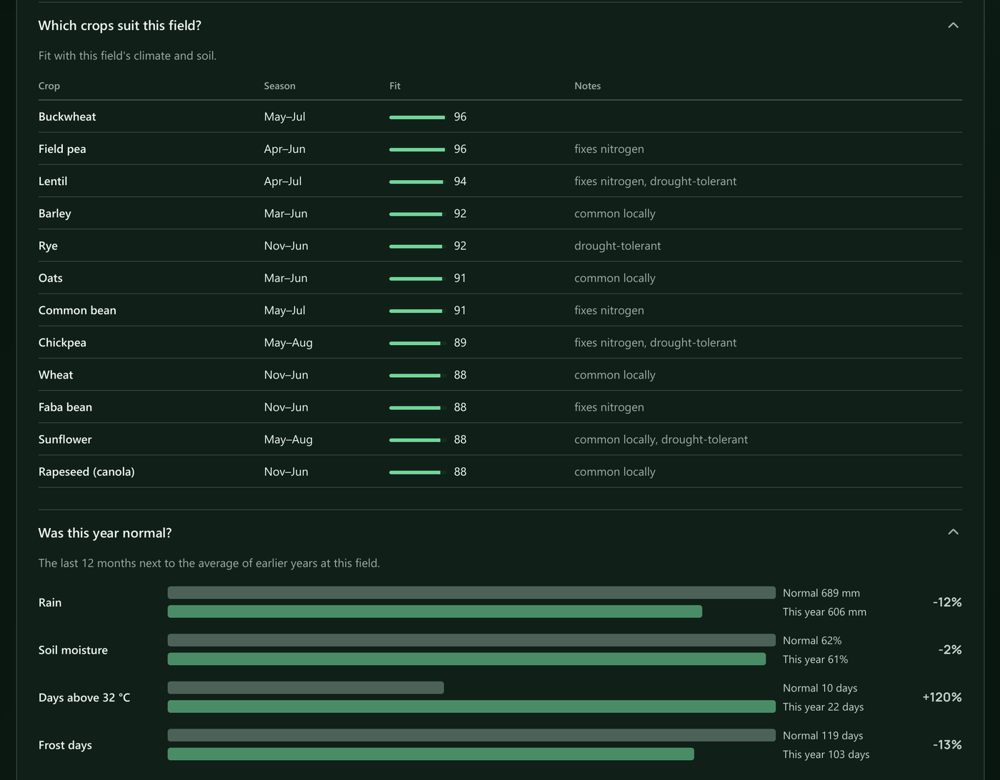
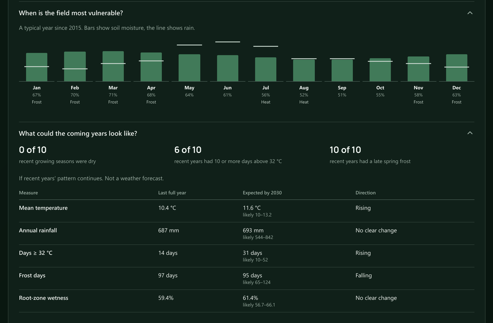
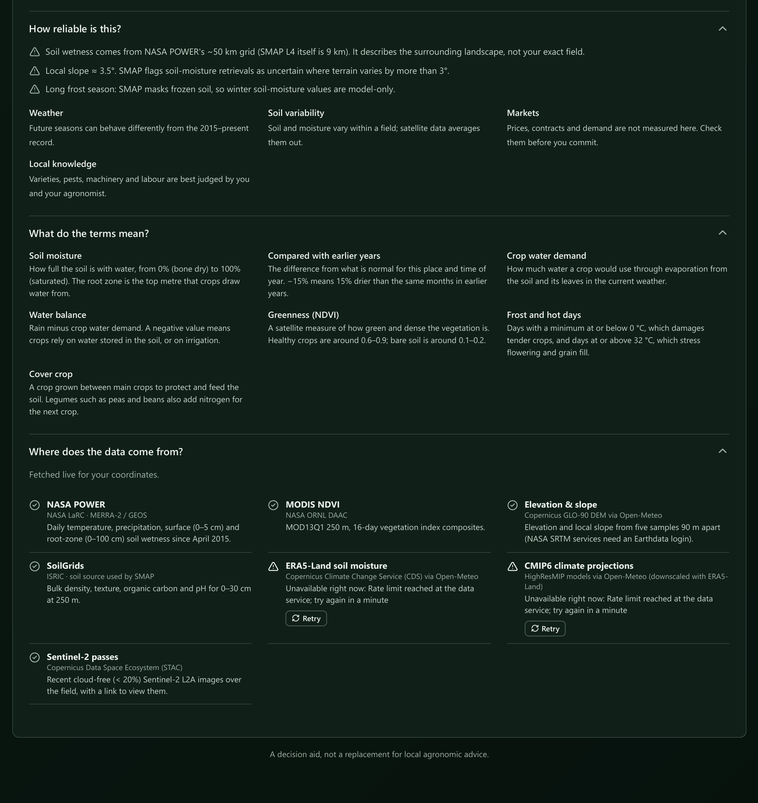
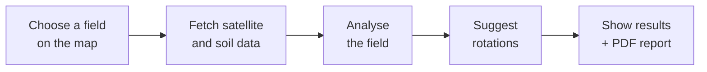
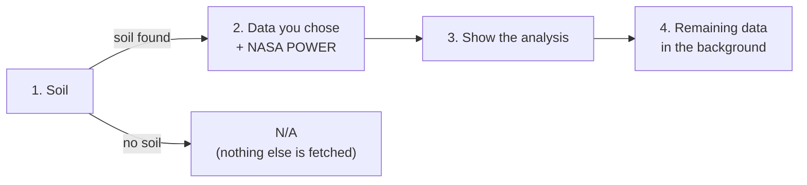
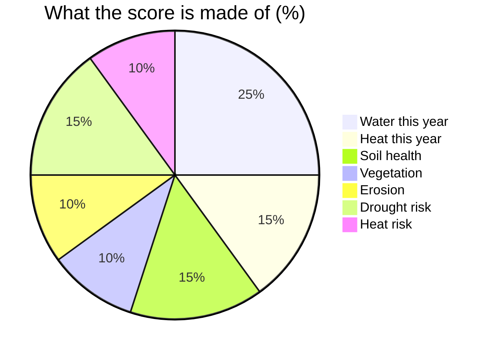
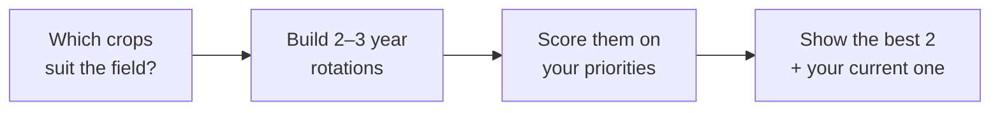

# AgroCycle

**Climate-smart crop rotations from NASA Earth observations.**

Pick a field anywhere on Earth. AgroCycle reads live satellite data for that spot, shows how the field is doing this year and suggests crop rotations that fit it. Each suggestion comes with a plain explanation of why it was picked, its risks and what is still unknown.

> A decision aid, not a prescription. The farmer makes the final call.

**Contents:** [Screenshots](#screenshots) · [Features](#features) · [How it works](#how-it-works) · [Data sources](#data-sources) · [Scores](#scores) · [Getting started](#getting-started) · [Project structure](#project-structure) · [Limitations](#limitations) · [Credits](#credits)

---

## Screenshots

### Landing page


### Field map
Pick a point, a rectangle or a polygon on satellite imagery, or search for a place, type coordinates or use your location. The buttons on the right open the data layers, the priorities and "Your farm".


### Loading the data
Soil is checked first. Then the chosen layers load and are ticked off as each one arrives.


### Example analysis
A complete analysis page for an 18 ha field in central Romania (45.9430, 24.9629), saved from the browser as a PDF.

📄 **[Open the full page as a PDF](docs/example/agrocycle-analysis-example.pdf)**

GitHub cannot show a PDF inside a README, so the same page is shown below as images, split into five parts.

<details open>
<summary><b>1 · Field resilience and the last 12 months</b></summary>


</details>

<details>
<summary><b>2 · Suggested rotation and the rotation options</b></summary>


</details>

<details>
<summary><b>3 · Which crops suit this field and was this year normal?</b></summary>


</details>

<details>
<summary><b>4 · When is the field most vulnerable and what could the coming years look like?</b></summary>


</details>

<details>
<summary><b>5 · How reliable is this, glossary and data sources</b></summary>


</details>

---

## Features

- **Any location**: click a point, draw a field, search a place or type coordinates.
- **Live data** from up to 12 sources (NASA, Copernicus, USDA, USGS…). Nothing is made up: a missing value shows "—".
- **Your choices**: pick the data you care about, your priorities (save water, soil health, heat, erosion, pests, income) and what you grow today.
- **Field resilience**: a score from 0 to 100 with a plain verdict and what is behind it.
- **Last 12 months**: key values coloured green, yellow or red compared with what is normal for the field.
- **Was this year normal?**: rain, soil moisture, hot days and frost days compared with earlier years.
- **Rotations**: your current rotation and the 2 best alternatives, each with a calendar, evidence, benefits, risks and unknowns.
- **Local crops**: rice in Japan, wheat and sunflower in Romania, millet in dry parts of India.
- **Climate test**: see how the ranking changes in a warmer or drier future.
- **Not farmable**: oceans, lakes, ice and cities show **N/A**.
- **PDF report**: download every value for the field.
- Light and dark theme, works on mobile.

---

## How it works



Everything runs in the browser. There is no database and no account. The only server code is a small proxy in `vite.config.ts` that keeps two API keys (NASS and OpenET) out of the browser.

### Loading order



- Soil comes first: on water, ice or a city there is nothing to farm, so nothing else is requested.
- Results are cached for 12 hours (climate projections for 30 days), so moving between pages costs no new requests.
- If a source fails, the page says so and offers **Try again**. It never fills in guessed values.

---

## Data sources

| Source | What it gives | Where |
|---|---|---|
| **NASA POWER** | Daily temperature, rain and soil moisture since 2015 | Worldwide |
| **NASA MODIS NDVI** | How green the vegetation is | Worldwide |
| **ISRIC SoilGrids** | Soil texture, organic matter, pH | Worldwide |
| **Copernicus DEM** | Elevation and slope | Worldwide |
| **ERA5-Land** (Copernicus) | Second opinion on soil moisture | Worldwide |
| **CMIP6 climate models** | Climate in 2041–2050 | Worldwide |
| **Sentinel-2** (Copernicus) | Latest clear satellite image | Worldwide |
| **USDA Web Soil Survey** | Drainage and water-holding capacity | US |
| **USGS Water Data** | Groundwater level at the nearest well | US |
| **USDA NASS** \* | Local crop yields | US |
| **OpenET** \* | Actual field water use | Western US |
| **OpenStreetMap Nominatim** | Place names | Worldwide |

\* needs a free API key (see [Getting started](#getting-started)).

The NASA SMAP documentation was used for the reliability notes, for example where satellite soil moisture is less accurate.

---

## Scores

### Field resilience (0–100)

How well the field is coping this year, plus its long-term risk. Each part gets a mark from 0 to 100. Parts without data are skipped, so a service being down never lowers the score.



| Score | Verdict |
|---|---|
| 75 or more | In good shape |
| 55–74 | Some pressure, worth watching |
| below 55 | Under significant pressure |

### Rotations



- **Crop fit**: every crop in the library (30 crops) is tested against the field's temperature, water, frost, heat and soil, month by month.
- **Local crops**: crops grown in the area (101 countries) are preferred.
- **Score**: 40% how well the crops fit the field and the local market, 60% your priorities. A priority you select counts double.
- **Strategies**: best overall, water-saving, soil builder, local market and, in hot places, heat-resilient.

### Outlook

- **Trends** in temperature, rain, hot days, frost days and soil moisture, with a likely range. If there is no clear trend, it says so instead of guessing.
- **Odds** of a dry season, a hot year or a late frost, from the last 10 years.
- **Climate models** (CMIP6) for 2041–2050.

---

## Getting started

You need Node.js 20.19+ and npm.

```bash
npm install
npm run dev        # http://localhost:5173
npm run build      # production build in dist/
```

**Optional API keys** for the US datasets NASS and OpenET:

```bash
cp .env.example .env    # add NASS_API_KEY and OPENET_API_KEY
npm run dev             # restart after editing .env
```

Without the keys, the app works normally and these two sources show "Not enabled".

---

## Project structure

```
src/
├── pages/        Home, Map, Analysis
├── components/   map, cards, rotation calendar, navigation…
├── services/     fetching the data (NASA, Copernicus, USDA…) and caching it
├── utils/        the analysis: field, crops, rotations, scores, PDF report
├── data/         crop library, local crops per country, NASA SMAP facts
└── types/        shared types
docs/             screenshots and the example analysis
vite.config.ts    proxy that keeps the API keys on the server
```

Key files: `utils/fieldAnalysis.ts` (field analysis and resilience score), `utils/rotations.ts` (rotations), `services/sourceStore.ts` (data loading).

---

## Privacy

- No accounts, no database. The selected field is kept only in the browser tab and cleared when it closes.
- Only the coordinates are sent to the data providers.
- API keys stay on the server and never reach the browser.

---

## Limitations

- Satellite data is coarse (NASA POWER ~50 km, MODIS 250 m), so differences inside a field are averaged out.
- The daily record starts in 2015, so trends rest on about 10 years.
- Prices, pests, varieties and machinery are not modelled. Each rotation lists what it cannot see.
- The NASS/OpenET proxy runs only with `npm run dev` or `npm run preview`.

---

## Credits

NASA (POWER, MODIS, SMAP) · ESA / Copernicus (Sentinel-2, ERA5-Land, DEM) · ISRIC SoilGrids · USDA (NRCS, NASS) · USGS · OpenET · Open-Meteo · OpenStreetMap

Built with React, TypeScript, Vite, Leaflet and Three.js.

## Team

Copiii Copaci IESC